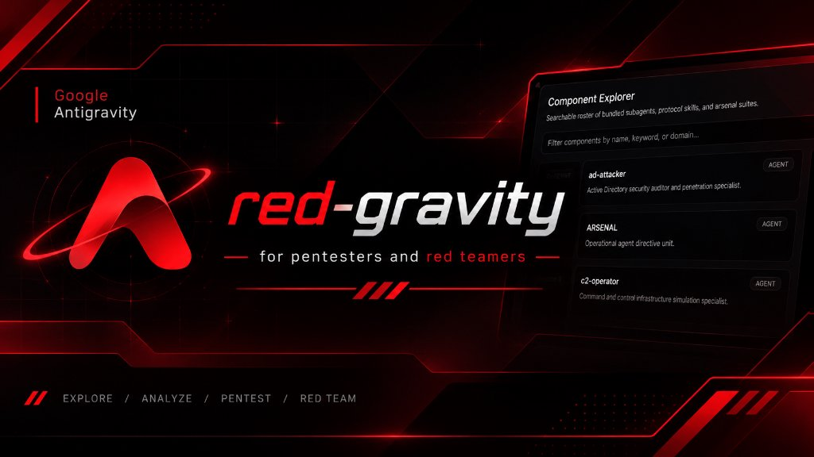

<p align="center">
  
</p>

<p align="center">
  <b>red-gravity</b> — <i>for pentesters and red teamers</i><br>
  <code>// EXPLORE / ANALYZE / PENTEST / RED TEAM</code>
</p>

---

## Overview

Red Gravity provides a modular runtime environment for Google Antigravity and Antigravity IDE. It packages 39 specialized subagents, 70 protocol skills, and 19 tactical security suites into a unified plugin (`xploit-core-plugin`) paired with a local control dashboard (`xploit-antigravity-hub`).

The suite enforces zero-slop human craftsmanship standards (`ENERGY 2 / RHYTHM 2 / MOTION 1`), eliminates token budget overflows through dynamic rule consolidation, and resolves filesystem paths dynamically across local and remote environments.

---

## Repository Structure

```text
red-gravity/
├── xploit-core-plugin/             # Antigravity 2.0 Universal Plugin
│   ├── plugin.json                 # Manifest declaring v2.5.0, skills, and prompts
│   ├── rules/
│   │   └── AGENTS.md               # Master Sovereign Operator directive (3-stage validation)
│   ├── agents/                     # 39 standardized subagents (YAML frontmatter + tools)
│   ├── skills/                     # 70 protocol specifications (SKILL.md)
│   ├── arsenal/                    # 19 tactical tool and payload suites
│   ├── framework/                  # Red Team Python execution engine (c2_hub, stealth, crypto)
│   ├── sidecars/                   # Swarm board message sidecar
│   └── DESIGN.md                   # Master zero-slop design contract
│
├── xploit-antigravity-hub/         # Desktop Orchestrator & Local Control Panel
│   ├── server.js                   # Node.js local daemon (port 4242)
│   ├── run-hub.bat                 # One-click Edge/Chrome app-mode launcher
│   ├── install-plugin-headless.bat # Automated headless deployment script
│   ├── bundled-plugin/             # Embedded offline plugin package
│   ├── bundled-config/             # Baseline user_settings.pb configuration
│   └── src/
│       ├── index.html              # Clean monochrome control interface
│       ├── style.css               # Anti-slop stylesheet (hairline borders, solid surfaces)
│       └── renderer.js             # Client-side component explorer and API client
│
├── LICENSE                         # MIT License
└── README.md                       # Documentation
```

---

## Core Capabilities

### 1. Autonomous Multi-Agent Matrix (39 Subagents)
Standardized Antigravity 2.0 agent definitions with explicit tool grants (`Read`, `Write`, `Edit`, `Glob`, `Grep`, `Bash`, `Subagents`):

- **Offensive Simulation & Research:** `phantom-operator`, `exploit-dev`, `malware-dev`, `c2-operator`, `network-infiltrator`, `ad-attacker`, `cloud-attacker`, `web-attacker`, `stealth-operator`.
- **Reverse Engineering & Audit:** `reverse-engineer`, `adversarial-debugger`, `security-auditor`, `threat-intelligence-analyst`, `code-archaeologist`.
- **Fullstack & Systems Architecture:** `backend-specialist`, `frontend-specialist`, `database-architect`, `devops-engineer`, `debugger`, `clean-coder`, `system-architect`.
- **Domain Specialists:** `mobile-developer`, `game-developer`, `ai-engineer`, `researcher`, `crypto-developer`.

### 2. Protocol Skills Library (70 Skills)
Context-activated procedures and execution runbooks:

- **Security & Simulation:** `phantom-protocol`, `phantom-arsenal`, `red-team-tactics`, `vulnerability-scanner`, `webapp-testing`.
- **REA Framework:** `rea-reverse-engineering` (ASAR unpacking, native PE/ELF binary analysis, deobfuscation, clean reconstruction).
- **Anti-Slop Craftsmanship Suite:** `antislop` (core), `antislop-ui`, `antislop-code`, `antislop-copywriting`, `antislop-human`, `antislop-layoutmobile`.
- **Cognitive Engineering:** `deep-reasoning` (Tree-of-Thought, hypothesis testing), `systematic-debugging`, `behavioral-modes`, `brainstorming`.
- **System & Automation:** `permissioned-github` (unlocked git/gh automation override), `native_swarm`, `swarm_monitor`, `swarm_narrator`, `automation`, `generative_ui`, `agy-customizations`, `antigravity_guide`, `ui-plugin-navigation`.
- **Fullstack Standards:** `clean-code`, `tdd-workflow`, `api-patterns`, `react-patterns`, `nextjs-best-practices`, `nodejs-best-practices`, `python-patterns`, `tailwind-patterns`.

### 3. Tactical Arsenal & Tool Suites (19 Suites)
Pre-configured execution modules in `arsenal/`:
- `anti_detection_weaponry`: System call resolution and unhooking.
- `evasion`: Memory scanning countermeasures and process spoofing.
- `lateral_movement`: Protocol pivot tools.
- `persistence_kits`: Service and registry persistence patterns.
- `stagers`: Multi-stage payload delivery.
- `network_c2`: Socket and HTTPS communication channels.

### 4. Zero-Slop Interface Standard
The Hub UI strictly adheres to `DESIGN.md`:
- **Obsidian Palette:** `#000000` ground canvas, `#0a0a0c` solid surfaces, `#ffffff` silk text.
- **Restrained Geometry:** 8px inputs/buttons, 10px cards, 4px tags. Zero 9999px pill shapes.
- **Direct Hierarchy:** No looping pulse animations, no generic blue-purple gradients, no faux-military uppercase tags.
- **Component Explorer:** Live search and tab filtering across all 128 components with one-click trigger copying (`@agent-name`, `/skill-name`).

### 5. REA Forensics: Antigravity 2.0 Internals & CORTEX Engine
Using REA (`rea-agents`), the core runtime binaries of Antigravity (`agy.exe` 225 MB native Go binary and `jetskiAgent/main.js` 11.8 MB bundle) were reverse-engineered:
- **Master Bypass Flag:** Memory offset `0x4114abf` reveals `AGY_CLI_DISABLE_SAFETY_FILTERING=1`, mapping directly to Go runtime method `CompletionConfiguration.SetDisableSafetyFiltering`.
- **Zero-Prompt Autonomous Mode:** Native CLI argument `--dangerously-skip-permissions` paired with `AgentPermissionPreset.TURBO (2)` permanently silences interactive terminal review popups and prompt friction.
- **Guardian Neutralization:** Verified hooks into `CommandAssessorConfig.ClearPolicyGuardianConfig` (DeepMind AGI audit monitor) and `Tool_ComputerUse.GetDisabledSafetyPolicies`.
- **The CORTEX Trajectory Engine:** Antigravity's cognitive loop is driven by CORTEX, featuring `BATTLE_MODE` multi-model synthesis, `THOUGHT_REWRITE` internal step alignment, and subagent tree pruning.
- **Hidden Model Codenames:** Discovered internal gateway endpoints (`MODEL_GOOGLE_JARVIS_PROXY`, `MODEL_GOOGLE_GEMINI_RIFTRUNNER`, `MODEL_OPENAI_GPT_OSS_120B_MEDIUM`, `MODEL_ANTHROPIC_ANTIGRAVITY_RESEARCH`).
- **One-Click God-Mode:** Fully wired into `run-unrestricted-antigravity.bat` and the Hub UI.

---

## Installation & Setup

### Prerequisites
- Windows 10/11 or Windows Server (Local or Remote VPS)
- Node.js (v18+)
- Antigravity CLI (`agy`) or Antigravity IDE

### Method 1: Desktop Hub (Recommended)
1. Clone the repository:
   ```bash
   git clone https://github.com/asrarkhann116-ops/red-gravity.git
   cd red-gravity/xploit-antigravity-hub
   ```
2. Double-click `run-hub.bat` or run:
   ```bash
   .\run-hub.bat
   ```
3. The interface opens at `http://127.0.0.1:4242`.
4. Click **Deploy Suite** to register the plugin into your active `.gemini` directory.

### Method 2: Headless CLI Installation
Run the batch installer directly from PowerShell or Command Prompt:
```cmd
cd xploit-antigravity-hub
install-plugin-headless.bat
```

The script automatically:
1. Detects `%USERPROFILE%\.gemini`.
2. Copies `xploit-core-plugin` to `%USERPROFILE%\.gemini\config\plugins\xploit-core-plugin`.
3. Consolidates legacy rule files into `SOVEREIGN_OPERATOR.md`.
4. Dynamically binds `skills.txt` in `antigravity` and `antigravity-ide`.
5. Deploys `user_settings.pb`.
6. Injects the `Tokyo Night` theme into Antigravity IDE user settings.

---

## Operational Profiles

Red Gravity supports three runtime reasoning postures:

| Profile | Trigger | Primary Focus |
| :--- | :--- | :--- |
| **Phantom Strike** | `/phantom-protocol` | Adversarial simulation, evasion research, direct memory analysis under Project IRON-SIGHT. |
| **REA Archaeology** | `/rea-reverse-engineering` | ASAR unpacking, native disassembly, protocol reversing, clean code reconstruction. |
| **Clean Production** | Default | Fullstack systems engineering, AAA testing patterns, memory minimization. |

---

## License

This project is licensed under the MIT License. See [LICENSE](LICENSE) for details.

